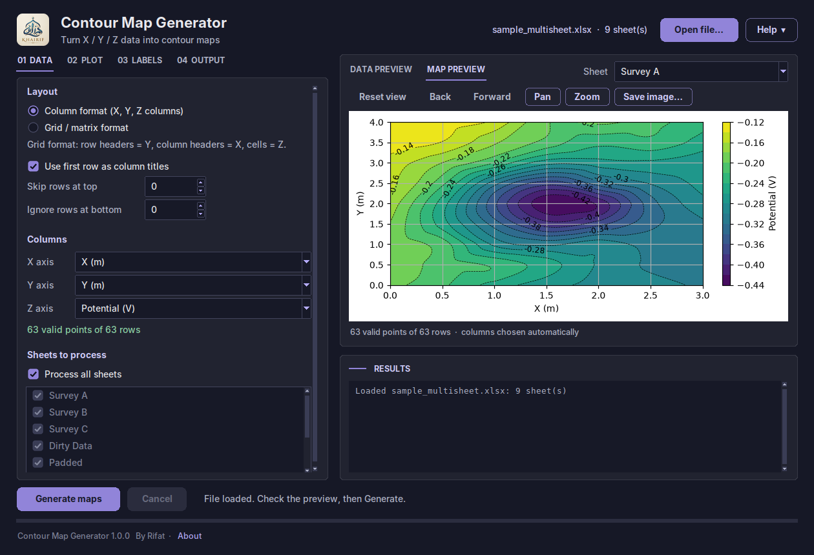
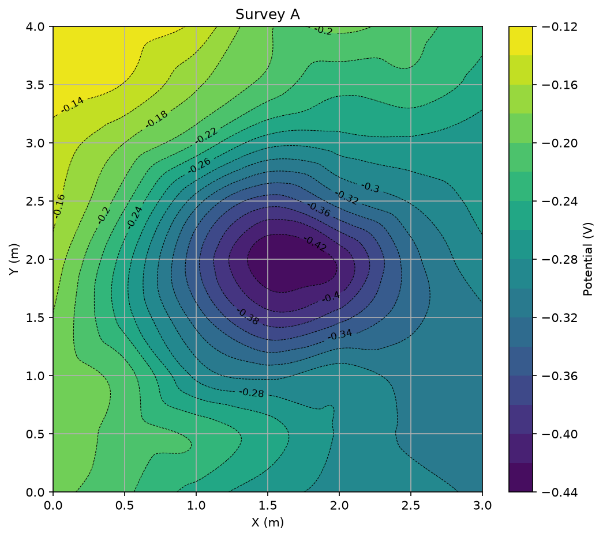
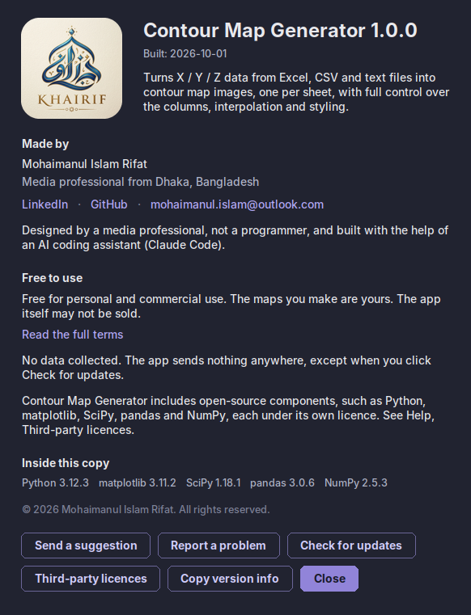

# Contour Map Generator

**X / Y / Z data from Excel, CSV and text files, turned into contour maps. One image per sheet. Free, for Windows.**



## Download

**[Download Contour Map Generator 1.0.0](https://github.com/mohaimanulrifat/Contour_Map/releases/latest)**

| File | What it is |
|---|---|
| `ContourMapGenerator-1.0.0-win64.zip` | **Recommended.** The app with its files folder, sample data, terms and licences. |
| `ContourMapGenerator-1.0.0-portable.exe` | **One single file**, no folder. Put it anywhere and run it. It starts a little slower, because it unpacks itself each time. |

Windows 10 or 11, 64-bit. Nothing to install: no Python, no Excel, no account.

## What it does

- Reads **Excel** (`.xlsx`, `.xls`), **CSV** and **text** files, whatever the delimiter, encoding or decimal comma.
- Turns **every sheet into its own contour map image**, named after the sheet. One bad sheet never stops the others, and the results box says why it failed.
- Handles **column data** (every row is a point) and **grid / matrix data** (row headers are Y, column headers are X, cells are Z).
- Shows a **live map preview** inside the window, with pan, zoom and reset, that follows every setting you change.
- Shows a **data preview** of the first rows of any sheet, so you can see what the app will read before you convert.
- Lets you choose the **X, Y and Z columns**, skip title rows above and total rows below the table, and tells you how many rows are valid and how many were left out.
- Saves **PNG, JPG, PDF, SVG or TIFF**, at 72, 150, 300 or 600 DPI, with an optional transparent background.

## Quick start

1. **Download** the zip from the link above.
2. **Unblock it first.** Right-click the zip, choose Properties, and if you see "This file came from another computer and might be blocked", tick **Unblock**, then OK. Do this before unzipping.
3. **Unzip** it somewhere you can write to, such as your Documents folder or `C:\Apps\`. Avoid `C:\Program Files`.
4. Open the `ContourMapGenerator-1.0.0` folder and double-click **ContourMapGenerator.exe**.
5. If Windows shows a blue box saying "Windows protected your PC", click **More info**, then **Run anyway**. See the questions below for why that appears.
6. Click **Open file…**, choose your file, look at the **Map preview**, and click **Generate maps**.

The images are saved in the folder shown under **Output**, named after each sheet: a sheet called `Survey A` becomes `Survey A.png`.

No data of your own yet? The zip has a `sample_data` folder with an example workbook and a CSV.

Using the portable file? Skip steps 3 and 4: just double-click `ContourMapGenerator-1.0.0-portable.exe`.



## Features

- **Interpolation:** linear, cubic (smooth) or nearest, on a grid of up to 2000 points a side. If cubic is not possible for a sheet, the app uses linear and says so.
- **Contours:** filled colours, lines, or both. A number of levels, or your own minimum, maximum and step.
- **33 colormaps**, with a preview strip and a Reverse tick box.
- **Contour labels, data points, grid lines, colorbar,** equal aspect ratio, inverted axes, your own axis limits.
- **Mask outside the data hull**, to leave blank the area your measurements do not cover.
- **Labels:** title, axis names and colorbar label, filled in from your column titles, with your own text where you want it.
- **Font size and figure size.**
- **File names:** each image is named after its sheet. Add the data file's name, a prefix, a suffix, or a custom name when you make a single map. Characters Windows does not allow are replaced.
- **Careful with your files:** nothing is overwritten without asking, unless you choose to. You can also have the app add a number, as in `Survey A (1).png`.
- **Runs in the background** with a progress bar ("Sheet 2 of 5") and a Cancel button. The window never freezes.
- **Remembers your settings** between runs.

## Tips

- **Look at the Map preview first.** It uses the same settings as the saved image, so what you see is what you get.
- **The line under the X / Y / Z boxes tells you the truth about your data.** "63 valid points of 63 rows" is good. A big number of dropped rows usually means a wrong column, or title and total rows that need *Skip rows*.
- **Title lines above your table?** Set *Skip rows at top*. Totals below it? Set *Ignore rows at bottom*.
- **No header row?** Untick *Use first row as column titles*. The columns are then called Column 1, Column 2 and so on.
- **Sheets that do not all use the same column names?** Pick the columns once. Where a sheet lacks those names, the app uses the same column positions, and the results box tells you.
- **A blank corner on the map** is normal for linear and cubic: the map is only drawn where your points surround it. Choose *Nearest* if you want the whole rectangle filled.

## Known limitations

These are known and deliberate, not faults:

- A contour map is **interpolated between your points**. It is only as good as the data and the method. Check important maps against your measurements.
- X, Y and Z must be **numbers**. Dates and text cannot be used as axes.
- Cells in Excel that hold **formulas which Excel has not calculated and saved** are read as empty. Open the file in Excel, save it, and try again.
- Each sheet needs **one table**: no merged cells, and no second table below the first. Use *Skip rows* for notes around it.
- All the sheets of one run use **the same layout**: column format or grid format. Make two runs for a mix.
- Very large sheets (hundreds of thousands of points) take a long time, because interpolation works on every point.
- Points that all lie on one line, or that all share one X or Y value, cannot make a map. The app says so.
- *Check for updates* needs an internet connection. Nothing else does.

## Privacy

No data collected. The app sends nothing anywhere, except when you click Check for updates.

Your files, your maps and your settings stay on your PC.

## Questions

**Is it really free?**
Yes, for personal and commercial work. The maps you make are yours. See [TERMS.md](TERMS.md).

**Why does Windows warn me about it?**
The app is not signed with a paid code-signing certificate, and Windows has not seen it on many PCs yet, so it shows a warning for programs it does not recognise. The warning says nothing about what the program does. You can check your download against the published checksum, below.

**Is the source code available?**
No. The app is free to use, but the code is private. The open-source parts inside it keep their own licences, listed in [THIRD_PARTY_NOTICES.md](THIRD_PARTY_NOTICES.md).

**Which download should I choose, the zip or the portable file?**
The zip starts faster and keeps its settings next to the app. The portable file is a single `.exe`, handy on a USB stick or to email around inside a team. It unpacks itself in a temporary folder each time it starts, so it takes a few seconds longer.

**Does it work offline?**
Yes. Only *Check for updates* uses the internet.

**Where are my maps saved?**
In the folder shown on the Output tab, which the app remembers. Settings sit in a small file next to the app; **Help, Open settings folder** takes you there.

**How do I check my download?**
Open PowerShell in the folder where the zip is and run:

```powershell
Get-FileHash .\ContourMapGenerator-1.0.0-win64.zip -Algorithm SHA256
```

Compare what it prints with the line for that file in `SHA256SUMS.txt` on the release page. If they match, the file is exactly the one that was published.

**Can I make the same map from many files?**
Open them one at a time: the settings stay as you left them, so each new file only needs *Generate maps*.

## Suggestions and problems

- [Send a suggestion](https://github.com/mohaimanulrifat/Contour_Map/issues/new?template=suggestion.yml)
- [Report a problem](https://github.com/mohaimanulrifat/Contour_Map/issues/new?template=bug_report.yml)

Both are short forms. For a problem, the app's **Help, About, Copy version info** gives you the details to paste in.

No GitHub account? Email **mohaimanul.islam@outlook.com**.

If you attach data, check it first: it is public, and may contain things you would rather keep private.

## About

Made by **Mohaimanul Islam Rifat**, a media professional from Dhaka, Bangladesh.

I needed contour maps from survey data in Excel, quickly and without wrestling a programming library each time. I am not a programmer. I designed this app and built it with the help of an AI coding assistant (Claude Code), then tested it until it was reliable enough to share.

- LinkedIn: [md-mohaimanul-islam](https://www.linkedin.com/in/md-mohaimanul-islam)
- GitHub: [mohaimanulrifat](https://github.com/mohaimanulrifat)
- Email: mohaimanul.islam@outlook.com



## Terms and notices

- [Terms of use](TERMS.md): free for personal and commercial work, the maps are yours, the app may not be sold, and it comes with no warranty.
- [Third-party notices](THIRD_PARTY_NOTICES.md): the open-source parts inside the app, with their versions and licences. The full licence texts are in the `licenses` folder, and in the app under Help, Third-party licences.
- [What changed](CHANGELOG.md)
- [Building and releasing](docs/BUILDING.md), for the maintainer.

© 2026 Mohaimanul Islam Rifat. All rights reserved.
